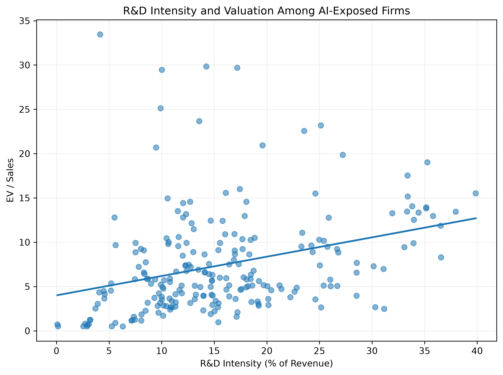
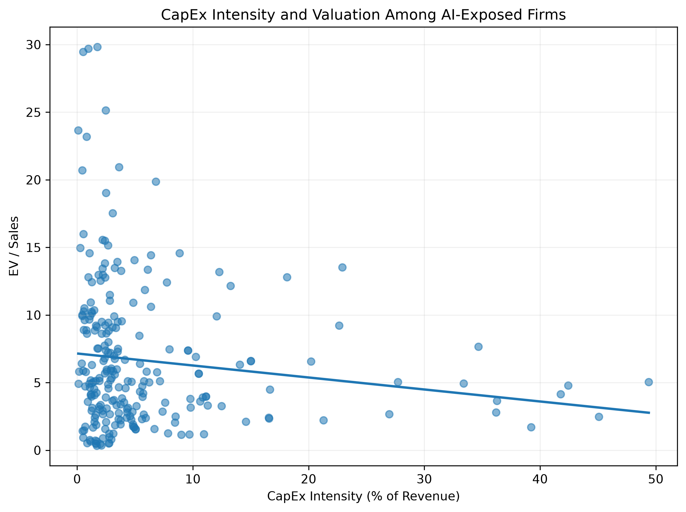

# AI Investment and Valuation Research

## Overview

This project looks at whether companies that invest more heavily in R&D and capital expenditures tend to trade at higher valuation multiples, specifically among large public companies that are actively discussing AI.

I focused on S&P 500 companies in the Information Technology and Communication Services sectors from 2021–2025.

The project combines SEC financial data, 10-K filing text, historical stock prices, and regression analysis. The main valuation measure is EV/Sales.

## Why I Built This

I wanted to build a finance project where I had to work with real public-company data instead of starting with a clean Kaggle-style dataset.

One thing that made the topic interesting is that companies generally do not report a separate number for “AI spending.” Because of that, I did not try to estimate AI investment directly. Instead, I used R&D and CapEx intensity as broader investment measures and then limited the analysis to company-years where AI was being discussed in the firm's 10-K.

This ended up being a mix of financial analysis, data engineering, text processing, and statistical modeling.

## Research Question

> Among AI-exposed U.S. public companies, are higher R&D and capital expenditure intensity associated with higher valuation multiples, and is that relationship stronger when later operating performance improves?

R&D and CapEx in this project represent total company investment, not direct AI spending.

## Company Sample

The starting universe includes 97 S&P 500 companies from:

- Information Technology
- Communication Services

The analysis covers fiscal years 2021–2025, giving a maximum possible panel of 485 company-year observations.

The final regression samples are smaller because some companies are missing certain accounting or valuation variables.

## AI Exposure

I classified AI exposure using each company's 10-K.

The filing text was searched for:

- artificial intelligence
- machine learning
- generative AI
- large language model
- large language models

A company-year was classified as AI-exposed if there were at least two total mentions across those terms.

Final classification:

- 348 AI-exposed company-years
- 118 non-AI-exposed company-years
- 19 company-years without a usable 10-K classification

This is meant to be a simple and reproducible classification rule, not a measure of how advanced a company's AI strategy is.

## Financial Variables

### Investment Measures

**R&D Intensity**

`R&D Expense / Revenue`

**CapEx Intensity**

`Capital Expenditures / Revenue`

### Valuation Measures

**Enterprise Value**

`Market Capitalization + Total Debt - Cash`

**EV / Sales**

`Enterprise Value / Revenue`

**Price / Sales**

`Market Capitalization / Revenue`

### Controls

The controlled regressions also include:

- Log total assets
- Leverage
- Sector
- Fiscal year

### Future Performance

I use next year's revenue growth as a simple measure of subsequent operating performance.

## Data Collection and Cleaning

Most accounting data comes from the SEC EDGAR Company Facts API.

One of the bigger challenges was that companies do not always use the same XBRL tags for the same economic concept. I built fallback logic for items such as:

- Revenue
- R&D
- CapEx
- Debt
- Cash
- Assets

Historical stock prices were collected with `yfinance`.

Shares outstanding came primarily from SEC filings, with a fallback to historical share data when necessary.

I also had to adjust historical shares for stock splits so the share counts were on the same basis as split-adjusted historical prices.

Missing accounting values were left missing instead of being assumed to be zero.

## Engineering Challenges

A large part of the project ended up being data-cleaning and edge-case handling.

### Inconsistent XBRL tags

Different companies often report the same type of financial item under different SEC XBRL tags. Using only one tag would have created a lot of missing data, so I built fallback rules for several variables.

### Fiscal-year differences

Not every company follows a normal calendar year. Some firms have January year-ends or 52/53-week fiscal calendars, which created cases where simply using the calendar year gave the wrong fiscal year.

### Stock splits

This caused one of the biggest errors I ran into.

For example, NVIDIA's older SEC share counts were on the share basis that existed at the time, while historical prices from Yahoo were already split-adjusted. Multiplying them directly produced a market capitalization that was obviously too low.

I fixed this by adjusting historical share counts for later stock splits before calculating market cap.

### Missing share data

Some companies did not have usable period-end common shares in the same SEC field. I added a historical-share fallback, and if there still was not a defensible value available, I left the observation missing.

### Filing metadata quirks

Some SEC filings reused fiscal-year labels in ways that created duplicate company-year observations. I added additional deduplication rules based on filing dates and period dates.

### Unbalanced regression sample

The full panel has 485 possible company-years, but the main regression only has 216 usable observations once all required variables are present.

I kept the missing observations as missing instead of forcing a balanced panel.

## Regression Setup

All regressions use OLS with HC3 heteroskedasticity-robust standard errors.

### Model 1: Baseline

EV/Sales is regressed on:

- R&D intensity
- CapEx intensity

Observations: **216**

### Model 2: Controlled

Adds:

- Log assets
- Leverage
- Sector fixed effects
- Fiscal-year fixed effects

Observations: **216**

### Model 3: Interaction

Adds:

- Future revenue growth
- R&D intensity × future revenue growth
- CapEx intensity × future revenue growth

The interaction variables are mean-centered.

Observations: **167**

## Results

## Results

| Variable | Baseline | Controlled | Interaction |
|---|---:|---:|---:|
| R&D intensity | 24.293*** | 28.092*** | 23.109*** |
| CapEx intensity | -10.273*** | -11.392*** | -10.517* |
| Future revenue growth | — | — | 11.876*** |
| R&D × Future growth | — | — | -19.186 |
| CapEx × Future growth | — | — | -27.830 |
| Log assets | — | 0.484 | 0.175 |
| Leverage | — | 4.128 | 3.712 |
| **Observations** | **216** | **216** | **167** |
| **R-squared** | **0.157** | **0.209** | **0.374** |

Significance levels:

- `***` p < 0.01
- `**` p < 0.05
- `*` p < 0.10

## What I Found

The clearest result was the relationship between R&D intensity and valuation.

R&D intensity was positively associated with EV/Sales in both the baseline and controlled models, and the relationship remained statistically significant after adding controls.

A one-percentage-point increase in R&D intensity was associated with roughly a 0.24–0.28 increase in EV/Sales in those specifications.

CapEx intensity showed the opposite pattern. It was negatively associated with EV/Sales in the baseline and controlled models.

Future revenue growth was positively associated with EV/Sales in the interaction model.

However, neither interaction term was statistically significant, so I did not find evidence that stronger future revenue growth made the R&D or CapEx valuation relationship stronger.

These are associations, not causal estimates.

## Figures

### R&D Intensity and EV/Sales



### CapEx Intensity and EV/Sales



## Project Structure

```text
ai-valuation-research/
├── data/
│   ├── raw/
│   └── clean/
├── figures/
│   ├── rd_intensity_vs_ev_sales.png
│   └── capex_intensity_vs_ev_sales.png
├── notebooks/
│   └── 01_data_collection.ipynb
├── methodology.md
├── README.md
└── requirements.txt
```

## Main Output Files

The cleaned outputs include:

- `final_analysis_dataset.csv`
- `ai_classification_2021_2025.csv`
- `basic_regression_sample.csv`
- `controlled_regression_sample.csv`
- `interaction_regression_sample.csv`
- `descriptive_statistics.csv`
- `regression_results_summary.csv`
- `regression_table_final.csv`

## Limitations

There are several limitations to the analysis.

The sample only includes large S&P 500 companies in technology and communication services, so the results may not apply to smaller firms or other industries.

R&D and CapEx are company-wide investment measures, not direct measures of AI spending.

The AI classification is based on keyword mentions in 10-K filings. It tells me whether AI-related topics were being discussed, but not how important AI was to the business.

Missing financial data reduced the usable regression sample.

There are also small timing differences between market-value dates and fiscal-year-end accounting values because shares-outstanding observations do not always fall exactly on fiscal year-end.

Some variables, especially revenue growth, contain large outliers.

Finally, the regressions are observational, so the results should not be interpreted as causal.

## Tools Used

- Python
- pandas
- NumPy
- requests
- lxml
- yfinance
- matplotlib
- statsmodels
- Jupyter Notebook
- SEC EDGAR APIs
